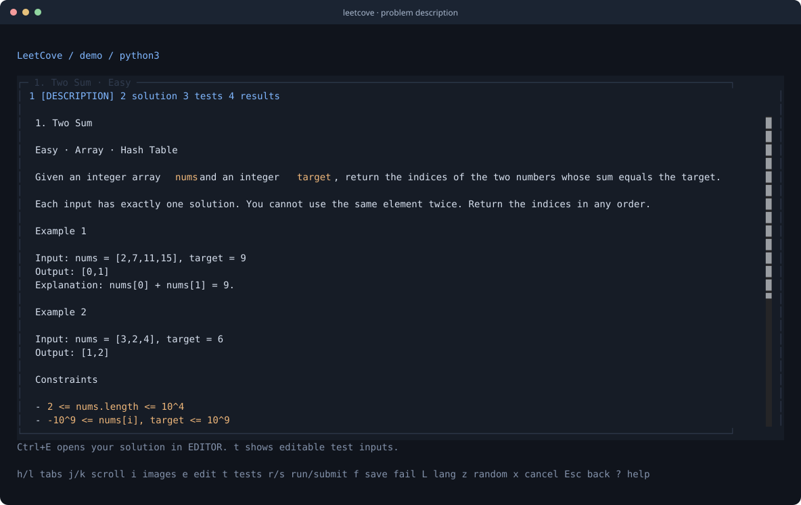
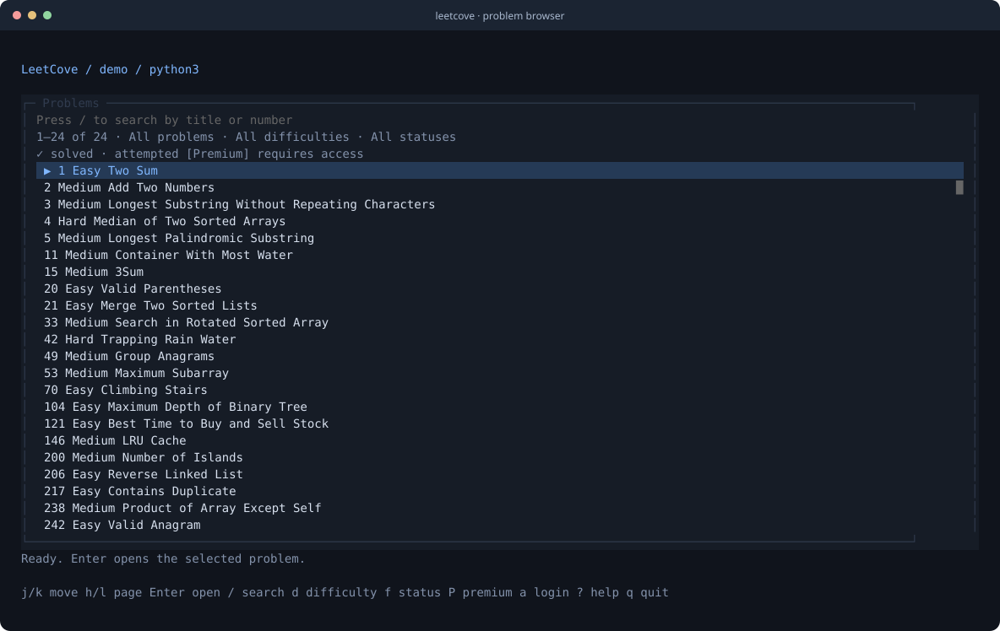
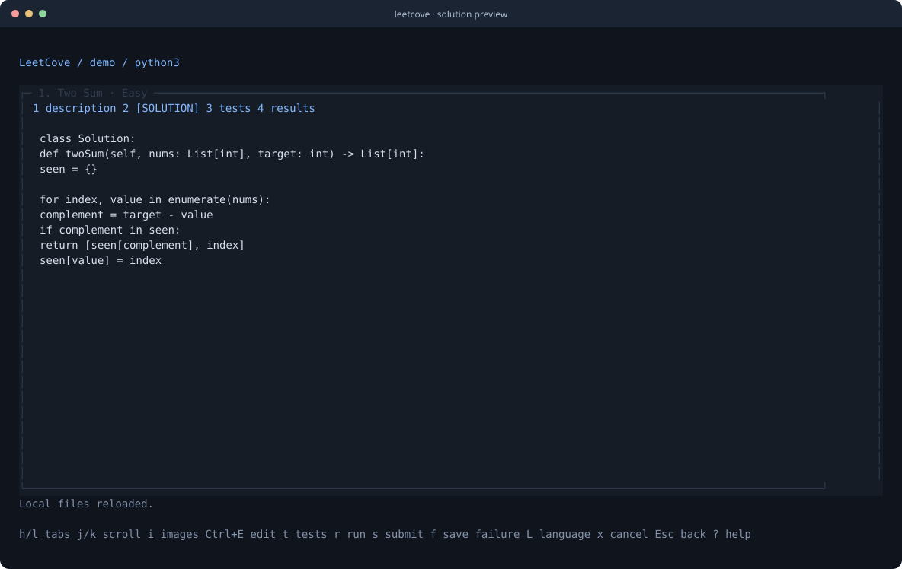

# LeetCove

**LeetCode, from your terminal.**

Browse problems, write solutions in your favorite editor, and run or submit them
without leaving a keyboard-first workflow. Built with TypeScript, Bun, and OpenTUI.

[](https://bun.sh/)
[](LICENSE)
[](https://github.com/Rustifan/leetcove/actions/workflows/ci.yml)



## Features

- **Find your next problem.** Search by title or number; filter by difficulty,
  progress, and free or Premium access.
- **Use your own editor.** Open solutions and custom tests in Neovim, Vim,
  VS Code, or any editor with a wait mode.
- **Run and submit.** Inspect per-case results, stdout, errors, runtime, and memory.
  Turn a failed submission's reported input into a local regression test.
- **Keep your work.** Solutions are stored locally, separately for each language.
  Recover your previous submitted code with a backup of the current file.
- **Pick up where you left off.** Restore your last problem, tab, scroll position,
  search, filters, and selection. Cached list pages remain available offline.

<details>
<summary>More screenshots</summary>

### Problem browser



### Solution preview



</details>

Screenshots are captured from the app with sample data.

## Getting started

You need [Bun](https://bun.sh/) **1.3.14 or newer**, an interactive terminal, and a
text editor. A Chromium-compatible browser is needed for sign-in.

Clone the repository and install its dependencies:

```sh
git clone https://github.com/Rustifan/leetcove.git
cd leetcove
bun install --frozen-lockfile
bun start
```

Open a specific problem:

```sh
bun start -- two-sum
```

To make the `leetcove` command available locally:

```sh
bun link
leetcove --help
leetcove two-sum
```

Public browsing works without an account. Test runs, submissions, personal
progress filters, and previous-code recovery require a saved LeetCode session.

## Sign in

```sh
bun run login
```

LeetCove opens LeetCode's sign-in page in a dedicated Chromium browser profile.
Complete your usual sign-in method and any browser verification. The session is
validated and saved with owner-only permissions, then the login window closes.
You can also press **a** inside the app.

Chromium and Google Chrome are detected automatically when available on `PATH`;
standard Chrome, Chromium, Brave, and Edge application locations on macOS are
also checked. To choose a browser explicitly:

```sh
LEETCOVE_BROWSER=/path/to/chromium bun run login
```

Check or remove the saved session:

```sh
bun start -- whoami
bun start -- logout
```

With `bun link`, the same commands are `leetcove login`, `leetcove whoami`, and
`leetcove logout`. Logout removes the saved session and dedicated browser profile;
your solution files are retained.

## Workflow

1. Search with **/**, navigate with **j/k**, and open a problem with **Enter**.
2. Press **L** to choose a language and **Ctrl+E** to open the solution in your editor.
3. Press **t** to view custom tests and **Ctrl+E** to edit them.
4. Press **r** to run your saved solution, or **s** to submit it to the full judge.
5. If a submission reports a failing input, press **f** to add it to your tests.

The terminal is released while your editor runs, and files are reloaded on return.
Editor selection uses the `editor` setting, then `$VISUAL`, then `$EDITOR`, then
`vi`. Quoted arguments are supported; graphical editors should use a wait flag.

```sh
EDITOR=nvim bun start
EDITOR="code --wait" bun start
```

### Custom tests

Tests start with the problem's examples. Use one compact JSON argument per line;
blank lines can separate cases. For Two Sum:

```text
[2,7,11,15]
9

[3,2,4]
6
```

String arguments need JSON quotes. Design problems use the operation and argument
arrays supplied in their examples. SQL and manual-format problems retain their
native input format.

**r** uses your custom tests; **s** evaluates the full LeetCode judge suite. Adding
a failed input preserves existing tests and skips duplicates. LeetCode normally
reports only the first failing input, rather than exposing its hidden suite.

### Keyboard shortcuts

**Global:** **a** signs in, **?** opens help, and **Ctrl+C** quits.

| Problem list | Action |
| --- | --- |
| `j` / `k`, arrows | Move selection |
| `h` / `l`, left/right | Previous / next page |
| `Enter` | Open problem |
| `/` | Search by title or number |
| `Enter` / `Esc` during search | Return focus to the list |
| `d` | Cycle difficulty |
| `f` | Cycle all / unstarted / attempted / solved |
| `P` | Cycle all / free / Premium |
| `g` / `G` | First / last item on the page |
| `Ctrl+d` / `Ctrl+u` | Move ten items |
| `R` | Refresh |
| `q` / `Esc` | Quit |

<details>
<summary>Problem-view shortcuts</summary>

| Key | Action |
| --- | --- |
| `h` / `l`, `Tab` / `Shift+Tab` | Switch Description / Solution / Tests / Results |
| `1` / `2` / `3` / `4` | Select a view directly |
| `j` / `k`, arrows | Scroll |
| `Ctrl+d` / `Ctrl+u` | Scroll half a page |
| `g` / `G` | Beginning / end |
| `Ctrl+E` or `e` | Edit the solution, or tests when the Tests view is active |
| `E` | Edit tests from any view |
| `b` / `v` / `t` / `o` | View description / solution / tests / results |
| `i` | Open a description image; choose one when there are several |
| `r` / `s` | Run custom tests / submit to the full judge |
| `f` | Add the failed submission's reported input to tests |
| `L` | Choose solution language |
| `p` | Restore your last submission, creating a local backup |
| `R` | Reload solution and tests from disk |
| `x` | Stop waiting for the current operation |
| `Esc` / `q` | Return to the list |

Uppercase shortcuts use **Shift**. Search mode handles ordinary typing without
triggering run or submit actions. Stopping an operation does not cancel a job
already sent to LeetCode.

</details>

## Configuration and files

Create `~/.config/leetcove/config.json` to set defaults:

```json
{
  "language": "python3",
  "editor": "nvim",
  "workspace": "/path/to/solutions"
}
```

Optional `browserExecutable` and `urlOpener` settings select the login browser and
description-image opener. Images use qutebrowser when installed, otherwise the
system opener. `LEETCOVE_BROWSER` and `LEETCOVE_OPENER` override their respective settings.

Choosing a language with **L** saves that preference. Set `workspace` or
`LEETCOVE_WORKSPACE` to select a solution directory.

| Data | Default location | Environment variable |
| --- | --- | --- |
| Configuration | `~/.config/leetcove/` | `XDG_CONFIG_HOME` |
| Session, browser profile, and navigation state | `~/.local/state/leetcove/` | `XDG_STATE_HOME` |
| Cached problem-list pages | `~/.cache/leetcove/` | `XDG_CACHE_HOME` |
| Solutions, tests, and results | `~/.local/share/leetcove/solutions/` | `XDG_DATA_HOME` |

Each problem has its own directory:

```text
1-two-sum/
  solution.python3.py
  solution.rust.rs
  tests.txt
  result.python3.json
```

Existing solutions are preserved when you reopen a problem. Cached list pages can
be used offline; fetching descriptions, signing in, running, and submitting need
a network connection. Premium problems require an account with access.

## Troubleshooting

- **Browser not found:** install Chromium or Google Chrome, or set `LEETCOVE_BROWSER`
  to the executable path.
- **Login or verification fails:** complete verification in the login window, or
  try another Chromium-compatible browser. Press **a** to renew an expired session.
- **Graphical editor returns immediately:** add its wait flag, such as `code --wait`.
- **Rate limit or network error:** the status area shows the error. Wait before
  retrying. Ambiguous run and submit requests are not automatically resent.

## Contributing

See [CONTRIBUTING.md](CONTRIBUTING.md) for development setup, coding conventions,
terminal checks, and screenshot generation.

```sh
bun run check
bun test
```

## License

[MIT](LICENSE).

LeetCove is an independent client for `leetcode.com` and is not affiliated with
LeetCode. It uses LeetCode's website APIs, which may change between releases.
